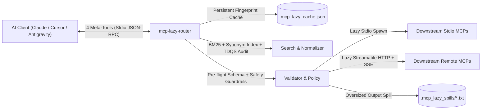

# mcp-lazy-router

**Dynamic Lazy-Loading MCP Router & Tool-Description Optimizer (TDQS)**

`mcp-lazy-router` eliminates upfront MCP context-window bloat ("context tax") across Claude Desktop, Claude Code, Cursor, VS Code, and Antigravity. Instead of injecting dozens or hundreds of raw upstream tool schemas at session startup, it exposes **4 high-scoring meta-tools** (`search_tools`, `get_tool_schema`, `call_tool`, `router_status`) and loads schemas and downstream connections strictly on demand.

Zero external dependencies — runs on pure Python 3.10+ stdlib.

---

## Architecture



### Core Capabilities
1. **Zero-Tax Progressive Disclosure:** Exposes only 4 meta-tools upfront (`tools/list`), cutting initial prompt token consumption dramatically as upstream servers scale.
2. **True Lazy Connections + Persistent Cache:** Warm cache loads from `.mcp_lazy_cache.json` in milliseconds with **0 downstream processes spawned** until `call_tool` executes.
3. **TDQS Auditor & Auto-Normalizer:** Evaluates every upstream tool on a 0–100 rubric across 6 dimensions (`purpose_clarity`, `usage_guidance`, `boundary_guidance`, `parameter_docs`, `safety_annotations`, `output_contract`) and enriches vague or missing descriptions deterministically without hallucination.
4. **Hybrid BM25 + Synonym Search:** Field-weighted Okapi BM25 over `camelCase`/`snake_case`-split names, servers, tags, descriptions, and parameters, with built-in synonym expansion (`pr`/`pull`, `db`/`sql`, `issue`/`ticket`, etc.).
5. **Pre-Flight Validation & Safety Guardrails:** Pure-Python JSON Schema validation prevents wasted downstream calls; `read_only` mode, allow/block globs, and `confirm_destructive` guardrails protect mutating endpoints.
6. **Oversized Response Spilling & Crash Recovery:** Truncates huge tool outputs cleanly to `max_response_chars`, writes full results to disk under `.mcp_lazy_spills/`, and safely retries crashed read-only/idempotent calls once.

---

## Quick Setup (Antigravity / Claude Desktop / Cursor)

1. Import your existing MCP config (automatically strips any self-referential `mcp-lazy-router` entry):

```bash
python scripts/run_router.py import-config path/to/claude_desktop_config.json --out router_config.json
```

2. Point your MCP client (`mcp_config.json` / `claude_desktop_config.json`) at the router:

```json
{
  "mcpServers": {
    "mcp-lazy-router": {
      "command": "python",
      "args": [
        "scripts/run_router.py",
        "serve",
        "--config",
        "router_config.json"
      ]
    }
  }
}
```

Or drop this repository directly into your plugins folder (`plugin.json` + `skills/mcp-lazy-router/SKILL.md` included).

---

## CLI Reference

| Command | Purpose |
| :--- | :--- |
| `serve --config <path> [--eager-index]` | Run the MCP stdio server |
| `index --config <path> [--server <name>]` | Refresh and persist downstream tool indexes |
| `audit --config <path> [--format table\|markdown\|json] [--refresh]` | Run TDQS quality audit across indexed tools |
| `search --config <path> <query> [--server <name>] [--read-only] [--limit 8]` | Test BM25 + synonym search from CLI |
| `inspect --config <path> <server> <tool>` | Inspect normalized schema and TDQS breakdown |
| `import-config <source> [--out <path>]` | Convert existing `mcpServers` config to router format |
| `benchmark --config <path>` | Measure upfront context token savings |
